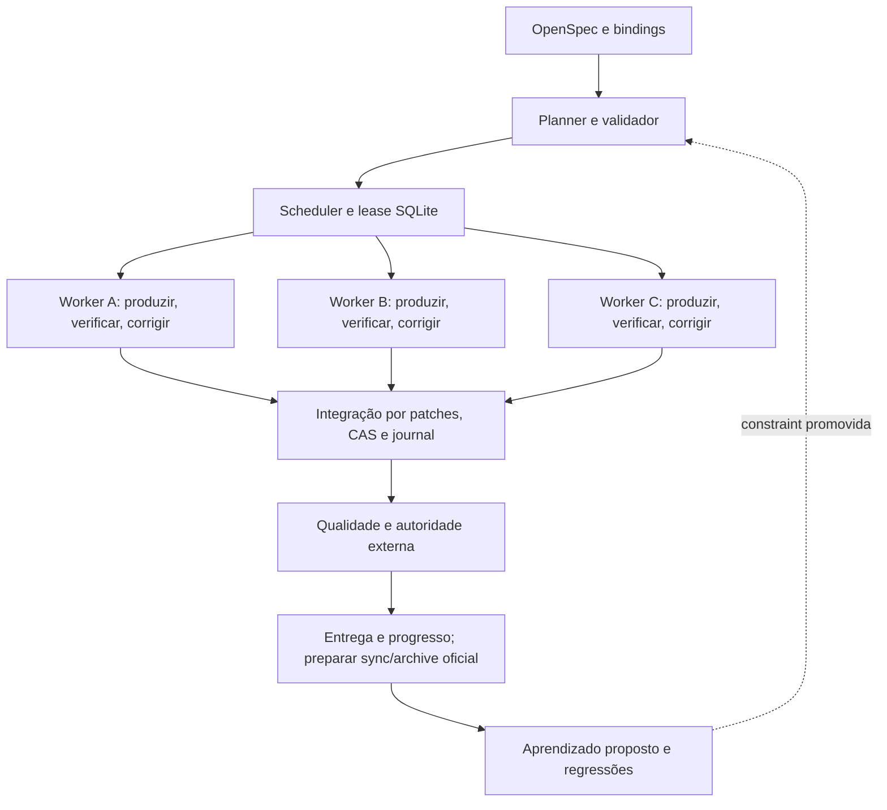

# Arquitetura TypeScript do LGO

OpenSpec mantém comportamento e planejamento; LGO mantém execução e autoridade. JSON Schema1.0 é a fronteira interoperável, enquanto interfaces TypeScript estritas descrevem a API de desenvolvimento.

As edges do DAG são dependências de dados. Correction Edge é controle interno da unidade. Gate é uma decisão de autoridade. Learning Edge atravessa execuções. Nenhum desses retornos cria ciclos artificiais no DAG.

| Módulo | Responsabilidade |
| --- | --- |
| `types.ts`, `contracts.ts` | Contratos tipados e validação Ajv2020 de mensagens externas |
| `openspec.ts` | Composição da CLI oficial JSON, metadados, cenários, tasks localizadas e sincronização segura |
| `graph.ts` | Bindings, produtores/consumidores, edges justificadas, cobertura, ciclos e conflitos |
| `engine.ts` | Scheduler, backpressure, recursos, loops, invalidação e recuperação |
| `adapters.ts` | Mock, processos sem shell e endpoints HTTP allowlisted, com AbortSignal |
| `verification.ts` | Oracles externos, schemas sem fetch remoto, escopo e CI por revisão |
| `merge.ts` | Snapshots, integração CAS, journal recuperável e rollback |
| `gates.ts` | Risco determinístico e autoridade HMAC externa ao worker |
| `state.ts`, `migration.ts` | SQLite durável, lease transacional e migração legada com backup |
| `learning.ts` | Candidatos, trial, promoção, contradição, histórico de versões e revogação |
| `observability.ts`, `cli.ts` | Eventos, métricas medidas e interface operacional |

Cada unidade produz patches em snapshot separado. Verificadores são configurados pelo operador e executados pelo controlador. A integração automática ocorre em workspace de run, sem alterar o checkout consumidor. Entrega e archive exigem gates adicionais. Tasks compartilhadas só são marcadas quando todas as unidades vinculadas possuem saídas verificadas e entregues.

SQLite usa WAL/synchronous FULL. Estado e evento de transição são gravados em transação. Journals resolvem a fronteira entre gravação de arquivo e checkpoint de unidade. O lease é adquirido em BEGIN IMMEDIATE e guarda PID/nonce; dois controladores vivos não podem executar o projeto. Retomada verifica história, plano, política, fontes e saídas.

A versão operacional do store é2; contratos continuam1.0. Migração de banco0.1 é explícita e testada com fixture real. A implantação em outro diretório não reescreve workspaces silenciosamente. Autorização depende de chave fora do projeto; o binding inclui domínio de runtime, resultado, política, run e ação.

| Aspecto | OpenSpec nativo | OpenSpec + LGO |
| --- | --- | --- |
| Produto | Proposal/specs/design/tasks | Mesmos artefatos preservados |
| Dependências | Tasks de implementação | DAG operacional com dados/recursos/justificativas |
| Apply | Workflow realizado pelo agente | Workers concorrentes e correção externa localizada |
| Conclusão | Progresso declarado | Estado verificado, integração e entrega separadas |
| Recuperação | Artefatos/contexto | Checkpoints e journals adicionais |
| Sync/archive | Workflows/CLI oficiais | Pré-gates do LGO; operações oficiais continuam separadas |
| Aprendizado | Contexto/regras do projeto | Propostas versionadas, trial, autoridade e revogação |

A primeira constraint aprendida é uma hipótese de recurso que exige aplicabilidade, trial e aprovação antes de ativar. Geração automática de skills/runbooks/testes não está implementada. LangGraph/Temporal foram avaliados, sem introduzir infraestrutura distribuída obrigatória. Não há exactly-once universal nem sandbox de kernel; processos/commands ainda exigem host confiável.

Versione fonte, schemas, templates, políticas e bindings revisados. Ignore bancos ativos, workspaces e backups. Retenção recomendada30dias é uma decisão do operador, sem coletor automático. Tokens/custos do mock não são medições de LLM.
