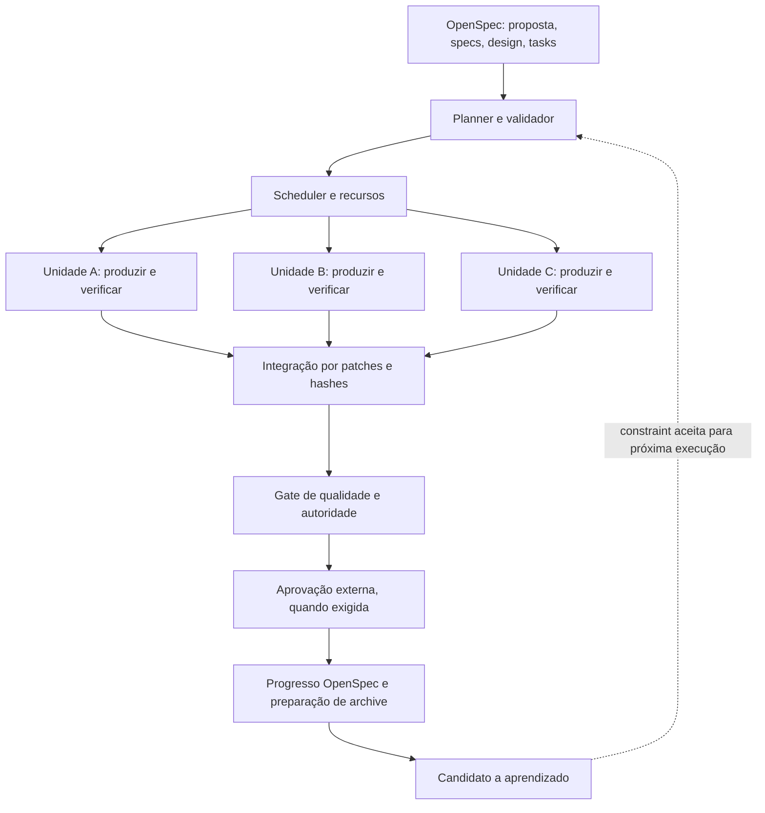

# Arquitetura do LGO

O OpenSpec mantém o comportamento esperado e os artefatos de planejamento. O LGO acrescenta contratos de execução, um DAG de unidades, loops locais, integração, gates e estado recuperável. O nome Loop & Graph Orchestration descreve essa responsabilidade e foi mantido.

O diagrama representa fluxo de controle. As dependências entre unidades são armazenadas separadamente no DAG. Uma correção volta ao mesmo worker com evidências e orçamento restante; esse retorno não cria uma dependência cíclica no DAG. O gate humano interrompe o avanço, sem mudar requisitos. O aprendizado operacional altera constraints de planejamento mediante validação e autoridade, sem editar `openspec/specs/`.

## Fronteiras

| Componente | Responsabilidade e fronteira de confiança |
| --- | --- |
| OpenSpec adapter | Usa CLI pública estruturada quando disponível; conserva artefatos e hashes de origem. `instructions apply --json` fornece tasks, seus caminhos e linhas; o adapter não presume que isso inclua contratos de execução. |
| Planner | Combina requisitos, tasks e bindings explícitos de entradas, saídas e verificadores. Não inventa dependências pelo nome nem pela ordem textual. Se faltam bindings, o plano deve ficar incompleto. |
| Validator | Rejeita ciclos, referências ausentes, cobertura incompleta, escopos inseguros, escritores concorrentes e verificadores vazios. |
| Scheduler | Escolhe unidades prontas, limita concorrência e recursos, persiste avanço e respeita dependências verificadas. |
| Worker e adapter | Recebem contexto delimitado e devolvem propostas de alteração. O resultado do agente não é prova de sucesso. |
| Loop e verificação | Aplicam patch em snapshot, executam verificadores externos, registram tentativa e retornam feedback localizado. |
| Merge | Integra somente resultado verificado, comparando a base com o destino; conflito exige ação explícita. |
| Gate | Avalia evidências, risco e autorização. Não aceita declaração de aprovação produzida pelo worker. |
| Store | SQLite guarda estados, tentativas e eventos recuperáveis; arquivos de evidência completam o registro. |
| Learning | Produz candidatos rastreáveis; promoção, contradição e revogação são decisões operacionais versionadas. |

## Isolamento e integração

Cada unidade recebe um snapshot separado dos arquivos permitidos/contexto. O adapter devolve alterações estruturadas, e o controlador aplica apenas caminhos autorizados. Isso permite testar o modelo sem conceder shell, rede ou acesso ao diretório real ao worker mock. Os verificadores são escolhidos pela configuração confiável, executados pelo controlador e não pelo texto retornado pelo agente.

O merge usa comparação de hashes contra a base observada. Um arquivo alterado por outra unidade ou pelo usuário não pode ser sobrescrito silenciosamente. A integração é local, em workspace de execução; não equivale a merge em branch remota, deploy ou publicação. Mudança em saída compartilhada invalida consumidores transitivos antes de uma nova integração. Alterações em plano e política exigem replanejamento explícito.

## Estado e invariantes

O modelo separa task descrita no OpenSpec de unidade executada no LGO. Uma task pode mapear várias unidades; seu checkbox somente é sincronizável quando todas as unidades vinculadas foram verificadas e integradas e o gate aceitou o resultado. Estado de planejamento do OpenSpec não implica conclusão operacional.

| Estado conceitual da unidade | Condição de avanço |
| --- | --- |
| PENDING / READY | Dependências aceitas, recursos disponíveis e plano válido |
| RUNNING | Tentativa persistida antes de chamar adapter |
| VERIFYING | Resultado disponível em snapshot, ainda não aceito |
| RETRYING | Falha corrigível e orçamento/tentativas disponíveis; feedback novo obrigatório |
| PASSED | Verificações externas aprovadas; hashes e evidências persistidos |
| FAILED / BLOCKED | Falha terminal, ambiente ausente, plano inadequado ou dependência impedida |
| WAITING_APPROVAL | Política exige autoridade externa antes de prosseguir |
| INVALIDATED | Entrada relevante mudou; resultado anterior conservado como histórico |
| CANCELLED | Cancelamento persistido; retomada exige decisão do controlador |

Os nomes efetivos do runtime estão no código e nos schemas; a tabela descreve a semântica. Uma execução global pode estar ativa, pausada, bloqueada, falha ou aceita. Aceita localmente continua diferente de arquivada no OpenSpec.

As transições permitidas, condições globais e classes de falha estão em [state-machine.md](state-machine.md).

Invariantes: unidade não inicia com dependência não aceita; limite de tentativas nunca é excedido; políticas e verificadores não vêm do worker; resultados aprovados não são produzidos novamente sem invalidação; retomada confere hashes da especificação e do grafo; evidência invalidada não pode sustentar gate; uma saída integrada deve corresponder à saída que foi verificada.

## Persistência, efeitos e recuperação

O store local é adequado a um controlador por execução. O limite distribuído não está resolvido por um arquivo SQLite. Checkpoint é estado operacional transacional, enquanto evento é evidência de uma transição; logs isolados não bastam para retomada.

Chamadas de agentes e comandos externos não recebem garantia universal de exactly-once. A referência restringe efeitos de workers a patches locais e usa estado persistido para preservar unidades aceitas. Um adapter que faça pagamentos, deploy ou outra ação externa precisa de chave de idempotência no provedor, consulta de estado e reconciliação. Na dúvida após uma interrupção, bloqueie em vez de repetir um efeito não idempotente.

## Armazenamento e retenção

Versione código, schemas, templates, políticas aprovadas e artefatos nativos OpenSpec. Considere bindings e planos revisados como configuração versionável. Ignore `.lgo/runs/`, snapshots, banco SQLite e evidências grandes; publique um pacote de evidência sanitizado quando necessário. Backup deve copiar banco de modo consistente e arquivos referenciados. Retenção recomendada: execuções falhas e aprovadas por 30 dias, decisões de autoridade e candidatos promovidos por prazo organizacional; essa retenção é uma política de operação, não um serviço automático de limpeza da referência.

## Observabilidade

Eventos correlacionam execução, unidade e tentativa. Durações e paralelismo devem vir de relógios e eventos reais. Tokens e custos ausentes permanecem desconhecidos; mock não mede uso de LLM. A API pode ser conectada a spans e métricas OpenTelemetry sem tornar um collector obrigatório. O relatório demonstrativo registra quais exportações e métricas foram de fato exercitadas.

O primeiro aprendizado executável é uma proposta de constraint de recurso, com promoção/revogação controladas e evidências de regressão. Rule, Skill, Eval, teste de regressão, template e runbook são alvos de extensão; não se alega um sintetizador completo dessas categorias. A proposta concreta precisa ser revisada por aplicabilidade e causalidade antes de generalizar.

## OpenSpec nativo e OpenSpec com LGO

| Aspecto | OpenSpec nativo | Composição OpenSpec + LGO |
| --- | --- | --- |
| Verdade de produto | Specs, deltas e histórico | Mesmos artefatos preservados |
| Planejamento | Proposal, design e tasks | Bindings rastreáveis e DAG validado |
| Execução | Ação apply realizada pelo agente | Scheduler com unidades, recursos e loops |
| Checkbox | Progresso declarado | Atualização derivada de evidência aceita |
| Recuperação | Contexto e artefatos do workflow | Checkpoints operacionais adicionais |
| Sync/archive | Workflows e CLI oficiais | Pré-gates adicionais; proteção não atribuída ao OpenSpec |
| Aprendizado | Contexto/regras do projeto | Candidatos e constraints operacionais controladas |
